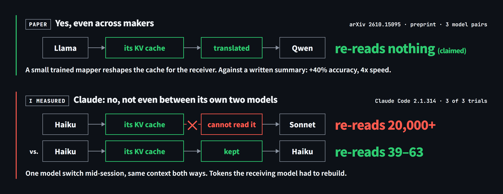

# claude-model-switch-tax

**Claude のプロンプトキャッシュはセッションではなくモデルごとに分かれる ── 途中でモデルを替えたときのキャッシュ再作成のコストを `claude -p` で実測**

同じセッションの途中で Haiku から Sonnet に替えたら、それまでのキャッシュは読まれなかった（3回中3回）── 会話を書き込み直したのは 20,136 トークン、替えずに続ければ 39〜63 トークンで済む

[Claude Code](https://code.claude.com/docs) 2.1.314、Claude Haiku 5.5 と Claude Sonnet 5.5 で測定



> Claude's prompt cache is split by model, not by session. In all 3 trials, Sonnet did not reuse the cache Haiku had written after a mid-session switch. It rewrote 20,136 tokens of the conversation, against 39–63 when the model stays the same. At API prices with 1-hour cache writes, that turn cost 23–36x the next one.

## 目的

途中でモデルを替える使い方（安いモデルで始めて、解決できなければ上位のモデルに替えるなど）で、プロンプトキャッシュがどう扱われるかを実測で確認する  
Claude Code や Claude API でエージェントを組んでいて、モデルの切り替えを設計に入れている人向け

[プロンプトキャッシュ](https://platform.claude.com/docs/en/build-with-claude/prompt-caching) ── リクエストの先頭部分を処理した結果をサーバー側でしばらく保持し、次のリクエストの先頭が同じならそれを再利用する仕組み。再利用できた分の料金は通常の入力の1割以下になる

背景 ── 別の会社のモデル同士で KV キャッシュを変換して受け渡す研究 [Swarm Telepathy](https://arxiv.org/abs/2610.15095)（MIT ほか、査読前）を読み、Claude ではモデルをまたいだときにキャッシュがどう扱われるかを確かめた  
Claude のプロンプトキャッシュが保持しているのも KV キャッシュ ── 上の Anthropic のドキュメントに、KV キャッシュを TTL の間メモリに保持すると書かれている

## 結果

- 同じモデルなら、セッションが別でもキャッシュヒットする（3回中3回）
- 同じセッションでも、Haiku から Sonnet に替えると、Haiku が書き込んだキャッシュは読まれず、Sonnet が書き込み直す（3回中3回）
- 書き込み直す量は 20,136 トークン ── 替えずに続ければ 39〜63 トークン。送る量はどちらも約3.2万トークンで、違うのはキャッシュから読むか書き込むか
- API 料金に換算すると、替えた回はその次の回の23〜36倍 ── TTL 1時間の書き込み料金で換算、TTL 5分なら15〜23倍

書き込み直すのは、替えた先のモデルにキャッシュが無い部分すべて ── 会話が長いほど大きくなる

[Claude Code の公式ドキュメント](https://code.claude.com/docs/en/prompt-caching)にも「Each model has its own cache」とあり、モデルを替えた次のリクエストは会話全体をキャッシュなしで読むと記載されている ── このリポジトリは、それを実測で確かめたもの  
同じページによると、キャッシュが共有されるのはモデル・速度（fast mode の有無）・先頭部分がすべて一致したときだけ ── モデルだけが条件ではない

表の値は結果 JSON の `usage` のトークン数 ── 書き込みは `cache_creation_input_tokens`（新しくキャッシュに書き込んだ分）、読み込みは `cache_read_input_tokens`（キャッシュから再利用した分）  
読み込み 12,417 は、システムプロンプトより前の部分（Claude Code が送るツール定義など）が、同じモデルで前に書き込んだキャッシュにヒットした分

### 同じセッションの途中でモデルを替える

`scripts/switch-in-session.sh` ── Haiku でセッションを開始し、Haiku で再開したあと、Sonnet で2回再開  
表の値は2回目と3回目の試行（この2回は同じ値だった）── 1回目はキャッシュが空から始まるぶん値が大きい  
モデルが替わるのは手順3だけ ── 手順2と手順4は前と同じモデルなので、切り替えが効いたのかを切り分けられる

| 手順 | 書き込み | 読み込み |
|---|---|---|
| 1. Haiku で開始 | 19,815 | 12,417 |
| 2. Haiku で再開 ── 同じモデルなら再開でも大半が読まれる（この 7,628 は実行によってばらつく、未確認事項を参照） | 7,628 | 24,642 |
| 3. Sonnet に替えて再開 ── Haiku が書き込んだ会話のキャッシュは読まれない | 20,136 | 12,417 |
| 4. Sonnet で再開 ── 替えたあとは Sonnet のキャッシュとして再利用される | 71 | 32,495 |

**替えなければ書き込みはほぼゼロ** ── 手順3でモデルを替えず Haiku のまま続けたときの書き込みは 39〜63 トークン（`MODEL_A=haiku MODEL_B=haiku bash scripts/switch-in-session.sh 3` で3回）

1回目の試行は、手順1が書き込み 32,232・読み込み 0、手順3が書き込み 32,553・読み込み 0 ── ツール定義のキャッシュも無いので読み込みが 0 になるだけで、手順3でキャッシュが読まれない点は3回とも同じ

### 別のセッションで同じ内容を送る

`scripts/across-sessions.sh` ── Haiku に2回、続けて Sonnet に2回、毎回新しいセッション（`--no-session-persistence`）  
3回の試行とも同じ値だった

| 手順 | 書き込み | 読み込み |
|---|---|---|
| 1. Haiku | 19,815 | 12,417 |
| 2. Haiku ── 別のセッションでも、1つ前が書き込んだ分がそのまま読まれる | 0 | 32,232 |
| 3. Sonnet ── 直前に Haiku が書き込んだ分は読まれない | 19,795 | 12,417 |
| 4. Sonnet ── Sonnet 同士なら、別のセッションでも読まれる | 0 | 32,212 |

### API 料金での換算

同じセッションの実験の、Sonnet に替えた回とその次の回を、トークン数と[料金表](https://platform.claude.com/docs/en/about-claude/pricing)から計算  
Claude Sonnet 5.5 の料金（100万トークンあたり、測定時）── 入力 $2、TTL 1時間の書き込み $4、TTL 5分の書き込み $2.50、読み込み $0.10、出力 $10

| 試行 | 替えた直後（手順3） | その次（手順4） | 倍率 | TTL 5分での倍率 |
|---|---|---|---|---|
| 1回目 ── ツール定義などの部分も書き込んだので倍率が高い | $0.1303 | $0.0036 | 36.4倍 | 23.4倍 |
| 2回目 | $0.0818 | $0.0036 | 22.8倍 | 14.9倍 |
| 3回目 | $0.0818 | $0.0036 | 22.8倍 | 14.9倍 |

結果 JSON の `total_cost_usd` は使っていない ── `--resume` で再開した回には、そのセッションの最初の回からの累計が入る（3回とも、各回を個別に計算した値の累計と一致）

### 測定条件

| 項目 | 内容 |
|---|---|
| Claude Code | 2.1.314 |
| 実行環境 | Windows 11、Git Bash（GNU bash 5.2）── macOS と Linux では未実行。スクリプトは bash 3.2（macOS の既定）にある構文だけで書いてあり、外部コマンドは `seq` `date` `mkdir` `cat` `dirname` のみ |
| モデル A | Claude Haiku 5.5（`--model haiku`） |
| モデル B | Claude Sonnet 5.5（`--model sonnet`） |
| 契約 | Claude のサブスク、使用量の上限内 ── この条件では Claude Code が TTL 1時間で書き込む（[公式ドキュメント](https://code.claude.com/docs/en/prompt-caching)）、TTL の設定は変更なし |
| システムプロンプト | `scripts/system-prompt.txt` ── 中身に意味はなく、キャッシュされる最小トークン数（モデルにより512〜4,096）を十分に超えて、書き込みと読み込みの差が見える長さにするための文章。先頭に回ごとに異なる1行を追加して、前の回のキャッシュを避けている |
| 入力の合計 | 約3.2万トークン（Claude Code が付けるツール定義などを含む） |
| プロンプト | `Reply with OK only.` |
| 実行順 | `switch-in-session.sh` のあとに `across-sessions.sh` ── 別のセッションの実験に読み込み 12,417 があるのは、先の実験でツール定義の部分が書き込まれていたため |

### 未確認事項

- 同じモデルで再開した回（同じセッションの実験の手順2）で、直前の書き込みの末尾およそ7,600トークンが読まれずに書き込み直される理由 ── 同じ条件でも起きたり起きなかったりして、起きないときの書き込みは200トークン未満。システムプロンプトを2倍にしても量が変わらず、手順1との間に8秒待っても変わらなかったので、システムプロンプトの長さでも書き込みの反映待ちでもない
- モデルごとにキャッシュが分かれる理由 ── Claude の内部構成は公開されておらず、公式ドキュメントにも理由の記載はない
- Claude Code を通さずに Claude API を直接呼ぶ場合 ── このリポジトリでは測っていない

## 実行方法

動作要件 ── Claude Code（ログイン済み）、bash（Windows は [Git for Windows](https://gitforwindows.org/) の Git Bash）、[Python](https://www.python.org/) 3.6 以降

1. リポジトリを取得

   ```
   git clone https://github.com/shumatsumonobu/claude-model-switch-tax.git
   cd claude-model-switch-tax
   ```

2. 実験を実行 ── 使用量を消費する（両方を既定の3回ずつ実行して、API 料金換算で約 $0.59）

   ```
   bash scripts/switch-in-session.sh   # 同じセッションの途中でモデルを替える。--resume を使うため、セッションが保存される
   bash scripts/across-sessions.sh     # 別のセッションで同じ内容を送る
   ```

   試行回数は引数で指定（既定は3）、比べるモデルは環境変数 `MODEL_A` `MODEL_B` で変更（既定は `haiku` と `sonnet`）

   ```
   MODEL_A=sonnet MODEL_B=opus bash scripts/switch-in-session.sh 1
   ```

3. 出力を確認 ── 手順ごとに `write=`（書き込み）と `read=`（読み込み）のトークン数が1行ずつ表示され、結果 JSON は `output/` に保存される。括弧内は書き込みの TTL ごとの内訳

   ```
   試行1 手順1 haiku（新規セッション）: write=19814 read=12417 (1h=19814 5m=0)
   試行1 手順2 haiku（再開）: write=7628 read=24641 (1h=7628 5m=0)
   試行1 手順3 sonnet（再開）: write=20135 read=12417 (1h=20135 5m=0)
   試行1 手順4 sonnet（再開）: write=71 read=32494 (1h=71 5m=0)
   ```

   上の表を測ったあと、別の機会に1回だけ走らせたときの表示 ── 表の2回目・3回目の値と1トークン差で一致した

   使われたモデルは結果 JSON の `modelUsage` で確認 ── `--resume` で再開した回には、そのセッションで前に使ったモデルも並ぶ、`haiku` `sonnet` が指すモデルは Claude Code のバージョンで変わる

### 手元で実行したときに違うもの

トークン数そのものは環境で変わる。同じになるのは、**手順3でモデルを替えたときに前のモデルが書き込んだ分が読み込まれないこと**と、**替えなければ書き込みがほぼゼロで済むこと**

| 変わるもの | 理由 |
|---|---|
| 読み込み 12,417（ツール定義などの部分） | MCP サーバーやプラグインを入れていると増える ── ツール定義は先頭部分に入る（[公式ドキュメント](https://code.claude.com/docs/en/prompt-caching)） |
| 書き込みの量 | 作業ディレクトリでも変わる ── 別のフォルダで試したら、手順1の書き込みが 19,815 から 20,818 になった |
| 料金の倍率 | API キーで使う場合は TTL が5分になるため、TTL 5分の列の値に近づく |

## ディレクトリ構成

```
claude-model-switch-tax/
├─ README.md
├─ LICENSE                   MIT
├─ .gitattributes            改行コードを LF に固定（トークン数が変わるため）
├─ docs/                     図の HTML と、書き出した PNG
│  ├─ overview.html / .png   上の図
│  └─ social-preview.html / .png   GitHub の Social preview 用
├─ CLAUDE.md                 このリポジトリを変更するときの決まり（使うだけなら不要）
├─ scripts/
│  ├─ switch-in-session.sh   同じセッションの途中でモデルを替える
│  ├─ across-sessions.sh     別のセッションで同じ内容を送る
│  ├─ cache_tokens.py        結果 JSON からキャッシュのトークン数を表示
│  └─ system-prompt.txt      実験用のシステムプロンプト（中身に意味はない）
└─ output/                   実行結果の JSON（Git 管理外）
```

## Author

週末ものづくり部 ── [@shumatsumonobu](https://x.com/shumatsumonobu)

## License

MIT ── see [LICENSE](LICENSE)
